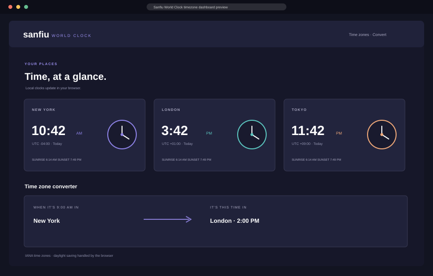

# Sanfiu Starter Kits

Independent full-stack website starters for different kinds of projects. Each kit has its own interface, Django app, database models, admin area, sample content, and setup guide. Download one folder, replace the demo name, copy, and images, then adapt the behavior for your project.

**Eight English-language kits · Python · Django · SQLite or PostgreSQL · MIT**

[Latest preview release](https://github.com/kavianpcx/Sanfiu-Starter-Kits/releases/tag/v0.3.0-preview.2) · [MIT license](https://github.com/kavianpcx/Sanfiu-Starter-Kits/blob/main/LICENSE) · [Contributing](https://github.com/kavianpcx/Sanfiu-Starter-Kits/blob/main/CONTRIBUTING.md) · [Roadmap](https://github.com/kavianpcx/Sanfiu-Starter-Kits/blob/main/ROADMAP.md)

## Choose a kit

Click a preview image or **Download ZIP** for that project's source bundle. **Source & setup** opens its code and project-specific instructions.

<table>
<tr><td width="50%" valign="top"><a href="https://github.com/kavianpcx/Sanfiu-Starter-Kits/releases/download/v0.3.0-preview.2/sanfiu-market.zip"></a><br><strong>Sanfiu Market</strong> · Product-led online store<br>Product search and categories, product pages, bag, guest checkout, customer accounts, order history, stock tracking, and admin.<br><a href="https://github.com/kavianpcx/Sanfiu-Starter-Kits/releases/download/v0.3.0-preview.2/sanfiu-market.zip">Download ZIP</a> · <a href="https://github.com/kavianpcx/Sanfiu-Starter-Kits/tree/main/templates/ecommerce/sanfiu-market">Source & setup</a></td><td width="50%" valign="top"><a href="https://github.com/kavianpcx/Sanfiu-Starter-Kits/releases/download/v0.3.0-preview.2/sanfiu-live.zip"></a><br><strong>Sanfiu Live</strong> · Event discovery<br>Editorial event pages, capacity-limited reservations, and admin-managed events.<br><a href="https://github.com/kavianpcx/Sanfiu-Starter-Kits/releases/download/v0.3.0-preview.2/sanfiu-live.zip">Download ZIP</a> · <a href="https://github.com/kavianpcx/Sanfiu-Starter-Kits/tree/main/templates/events/sanfiu-live">Source & setup</a></td></tr>
<tr><td width="50%" valign="top"><a href="https://github.com/kavianpcx/Sanfiu-Starter-Kits/releases/download/v0.3.0-preview.2/sanfiu-marketplace.zip"></a><br><strong>Sanfiu Marketplace</strong> · Multi-vendor store<br>Seller applications, moderated listings, seller pages, orders, and fulfillment workflows.<br><a href="https://github.com/kavianpcx/Sanfiu-Starter-Kits/releases/download/v0.3.0-preview.2/sanfiu-marketplace.zip">Download ZIP</a> · <a href="https://github.com/kavianpcx/Sanfiu-Starter-Kits/tree/main/templates/marketplace/sanfiu-marketplace">Source & setup</a></td><td width="50%" valign="top"><a href="https://github.com/kavianpcx/Sanfiu-Starter-Kits/releases/download/v0.3.0-preview.2/sanfiu-academy.zip"></a><br><strong>Sanfiu Academy</strong> · Online learning<br>Course catalog, learner accounts, enrollment, lessons, and progress tracking.<br><a href="https://github.com/kavianpcx/Sanfiu-Starter-Kits/releases/download/v0.3.0-preview.2/sanfiu-academy.zip">Download ZIP</a> · <a href="https://github.com/kavianpcx/Sanfiu-Starter-Kits/tree/main/templates/education/sanfiu-academy">Source & setup</a></td></tr>
<tr><td width="50%" valign="top"><a href="https://github.com/kavianpcx/Sanfiu-Starter-Kits/releases/download/v0.3.0-preview.2/sanfiu-tickets.zip"></a><br><strong>Sanfiu Tickets</strong> · Cinema and attraction tickets<br>Cinema and attraction discovery, buyer accounts and reservation history, seller offers and approval, and quantity-limited bookings.<br><a href="https://github.com/kavianpcx/Sanfiu-Starter-Kits/releases/download/v0.3.0-preview.2/sanfiu-tickets.zip">Download ZIP</a> · <a href="https://github.com/kavianpcx/Sanfiu-Starter-Kits/tree/main/templates/ticketing/sanfiu-tickets">Source & setup</a></td><td width="50%" valign="top"><a href="https://github.com/kavianpcx/Sanfiu-Starter-Kits/releases/download/v0.3.0-preview.2/sanfiu-devices.zip"></a><br><strong>Sanfiu Devices</strong> · Product showcase<br>Original product pages, device specifications, and inquiry management.<br><a href="https://github.com/kavianpcx/Sanfiu-Starter-Kits/releases/download/v0.3.0-preview.2/sanfiu-devices.zip">Download ZIP</a> · <a href="https://github.com/kavianpcx/Sanfiu-Starter-Kits/tree/main/templates/showcase/sanfiu-devices">Source & setup</a></td></tr>
<tr><td width="50%" valign="top"><a href="https://github.com/kavianpcx/Sanfiu-Starter-Kits/releases/download/v0.3.0-preview.2/sanfiu-weather.zip"></a><br><strong>Sanfiu Weather</strong> · Weather dashboard<br>Current conditions, an hourly forecast, a 10-day outlook, city search, and admin-editable sample data.<br><a href="https://github.com/kavianpcx/Sanfiu-Starter-Kits/releases/download/v0.3.0-preview.2/sanfiu-weather.zip">Download ZIP</a> · <a href="https://github.com/kavianpcx/Sanfiu-Starter-Kits/tree/main/templates/utilities/sanfiu-weather">Source & setup</a></td><td width="50%" valign="top"><a href="https://github.com/kavianpcx/Sanfiu-Starter-Kits/releases/download/v0.3.0-preview.2/sanfiu-world-clock.zip"></a><br><strong>Sanfiu World Clock</strong> · Time zones<br>Live local clocks, IANA time zones, and browser-side time conversion.<br><a href="https://github.com/kavianpcx/Sanfiu-Starter-Kits/releases/download/v0.3.0-preview.2/sanfiu-world-clock.zip">Download ZIP</a> · <a href="https://github.com/kavianpcx/Sanfiu-Starter-Kits/tree/main/templates/utilities/sanfiu-world-clock">Source & setup</a></td></tr>
</table>

The gallery images are illustrative interface previews, not screenshots captured from running applications. Each project's preview is provided in its folder as `preview.svg`. Account flows are included where the project calls for them: customer orders in the store, buyer and seller accounts for tickets, seller accounts in the marketplace, and learner accounts in the academy. Public tools such as weather and world clocks remain usable without an account.

## Run a project locally

Download and extract one ZIP, then open a terminal in that project's folder:

```bash
python -m venv .venv
source .venv/bin/activate
python -m pip install -r requirements.txt
cp .env.example .env
python manage.py migrate
python manage.py seed_demo
python manage.py createsuperuser
python manage.py runserver
```

On Windows PowerShell, activate with `.venv\Scripts\Activate.ps1` and copy the environment file with `Copy-Item .env.example .env`. Then visit [http://127.0.0.1:8000](http://127.0.0.1:8000) and [http://127.0.0.1:8000/admin/](http://127.0.0.1:8000/admin/). Each kit has its own README with features and any additional setup.

For PostgreSQL, set a local password in `.env` and follow the project's Docker Compose instructions.

## Sample data and production use

The kits provide project-specific flows and editable code, but are not production services. Store and marketplace checkouts do not charge cards. Ticket reservations are unpaid and do not issue scannable admission tickets. Weather values are demo records, not live forecasts. Configure payment, email, security, hosting, backups, and any requirements for your use case. Replace remote sample image URLs with assets you have permission to use.

The software is licensed under MIT. Sample photographs and external services have separate terms.
