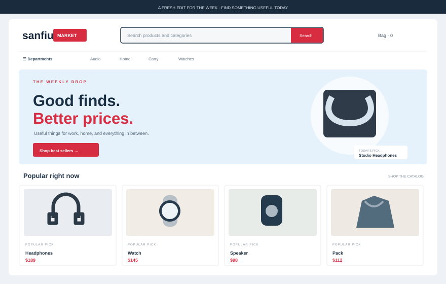
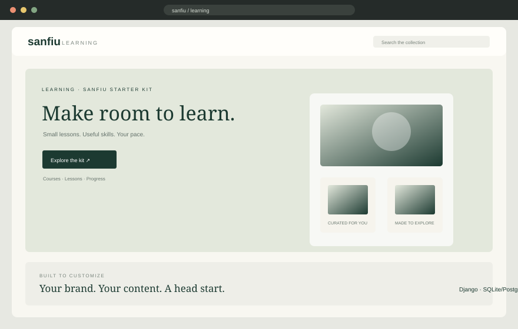

# Sanfiu Starter Kits

A growing collection of independent, full-stack website starters. Pick a project, download its ZIP, change the brand and content, then run it locally. Every kit has its own frontend, backend, database models, sample data, admin workflow, and setup guide.

**Open source:** [MIT licensed](LICENSE). Sample photos and third-party services have their own terms; see each kit README.

## Project gallery

Click a preview image or the ZIP link directly below it to download that starter. Use the source link for its setup instructions and code.

<table>
<tr><td width="50%" valign="top"> <strong>Sanfiu Market</strong> · Storefront <a href="https://raw.githubusercontent.com/kavianpcx/Sanfiu-Starter-Kits/feat/first-store-template/downloads/sanfiu-market.zip">Download ZIP ↘</a> · <a href="templates/ecommerce/sanfiu-market/">Source & setup</a></td>
<td width="50%" valign="top"> <strong>Sanfiu Live</strong> · Events <a href="https://raw.githubusercontent.com/kavianpcx/Sanfiu-Starter-Kits/feat/first-store-template/downloads/sanfiu-live.zip">Download ZIP ↘</a> · <a href="templates/events/sanfiu-live/">Source & setup</a></td></tr>
<tr><td width="50%" valign="top"> <strong>Sanfiu Marketplace</strong> · Marketplace <a href="https://raw.githubusercontent.com/kavianpcx/Sanfiu-Starter-Kits/feat/first-store-template/downloads/sanfiu-marketplace.zip">Download ZIP ↘</a> · <a href="templates/marketplace/sanfiu-marketplace/">Source & setup</a></td>
<td width="50%" valign="top"> <strong>Sanfiu Academy</strong> · Learning <a href="https://raw.githubusercontent.com/kavianpcx/Sanfiu-Starter-Kits/feat/first-store-template/downloads/sanfiu-academy.zip">Download ZIP ↘</a> · <a href="templates/education/sanfiu-academy/">Source & setup</a></td></tr>
<tr><td width="50%" valign="top"> <strong>Sanfiu Tickets</strong> · Tickets <a href="https://raw.githubusercontent.com/kavianpcx/Sanfiu-Starter-Kits/feat/first-store-template/downloads/sanfiu-tickets.zip">Download ZIP ↘</a> · <a href="templates/ticketing/sanfiu-tickets/">Source & setup</a></td>
<td width="50%" valign="top"> <strong>Sanfiu Devices</strong> · Devices <a href="https://raw.githubusercontent.com/kavianpcx/Sanfiu-Starter-Kits/feat/first-store-template/downloads/sanfiu-devices.zip">Download ZIP ↘</a> · <a href="templates/showcase/sanfiu-devices/">Source & setup</a></td></tr>
<tr><td width="50%" valign="top"> <strong>Sanfiu Weather</strong> · Weather <a href="https://raw.githubusercontent.com/kavianpcx/Sanfiu-Starter-Kits/feat/first-store-template/downloads/sanfiu-weather.zip">Download ZIP ↘</a> · <a href="templates/utilities/sanfiu-weather/">Source & setup</a></td>
<td width="50%" valign="top"> <strong>Sanfiu World Clock</strong> · Time zones <a href="https://raw.githubusercontent.com/kavianpcx/Sanfiu-Starter-Kits/feat/first-store-template/downloads/sanfiu-world-clock.zip">Download ZIP ↘</a> · <a href="templates/utilities/sanfiu-world-clock/">Source & setup</a></td></tr>
</table>

## Quick start

1. Choose a kit above and download its ZIP, or open its source folder.
2. Follow that kit's README to install dependencies and create its local database.
3. Replace the sample name, colors, images, and content.
4. Review the deployment notes before putting a site online.

Most kits use Django 5.2, SQLite for local development, and PostgreSQL through Docker Compose. Each folder is a separate project and can be deployed independently.

## Included templates

- **Sanfiu Market:** storefront, cart, inventory, orders, and admin.
- **Sanfiu Live:** event discovery and capacity-limited reservations.
- **Sanfiu Marketplace:** seller onboarding, moderated products, and seller-specific order workflows.
- **Sanfiu Academy:** courses, learner accounts, enrollments, lessons, and progress tracking.
- **Sanfiu Tickets:** event listings, seller ticket offers, admin moderation, and quantity-limited reservations.
- **Sanfiu Devices:** original product showcase, specifications, and inquiry management.
- **Sanfiu Weather:** sample city conditions and daily forecast records, with a documented provider integration point.
- **Sanfiu World Clock:** live local clocks and browser-side time-zone conversion.

These are preview starters, not turnkey production services. Payment processing, private media, email delivery, fraud checks, and jurisdiction-specific requirements need to be configured for the chosen business.

## Contributing

See [CONTRIBUTING.md](CONTRIBUTING.md) for the structure and documentation each new kit should include. See [ROADMAP.md](ROADMAP.md) for future starter ideas. Regenerate downloads with `python scripts/package_templates.py`.
