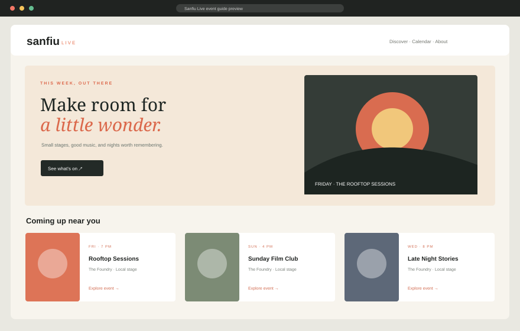
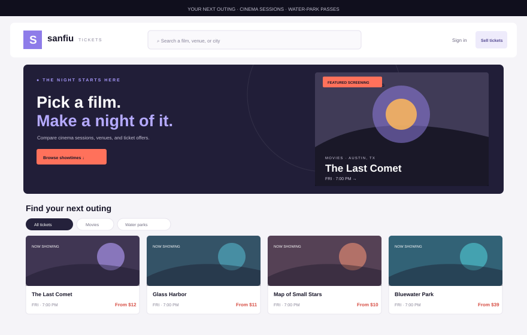
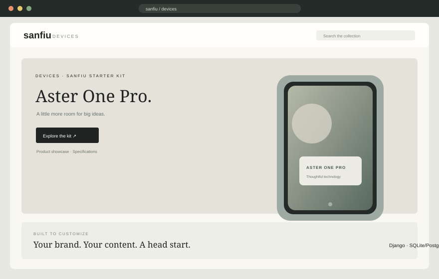
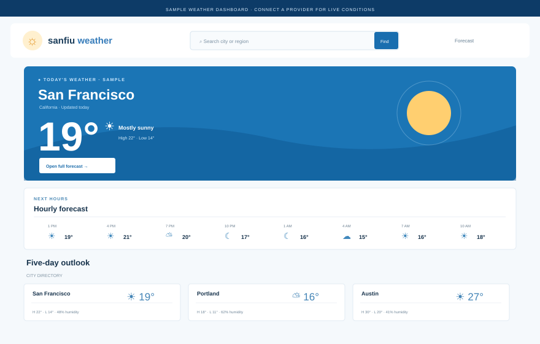

# Sanfiu Starter Kits

A collection of independent, full-stack website starters. Choose a project, download its ZIP, customize the name, colors, content, and images, then run it locally.

**Eight English-language starter projects.** Each kit has a Django frontend and backend, database models and migrations, an admin area, demo data, and its own setup guide. SQLite is ready for local development; PostgreSQL is available through Docker Compose.

[Preview release v0.2.0-preview.1](https://github.com/kavianpcx/Sanfiu-Starter-Kits/releases/tag/v0.2.0-preview.1) · [MIT license](https://github.com/kavianpcx/Sanfiu-Starter-Kits/blob/v0.2.0-preview.1/LICENSE) · [Contributing](https://github.com/kavianpcx/Sanfiu-Starter-Kits/blob/v0.2.0-preview.1/CONTRIBUTING.md) · [Roadmap](https://github.com/kavianpcx/Sanfiu-Starter-Kits/blob/v0.2.0-preview.1/ROADMAP.md)

## Project gallery

Click a preview image or the **Download ZIP** link below it to download that project. Open **Source & setup** for its code and project-specific instructions.

<table>
<tr><td width="50%" valign="top"><a href="https://raw.githubusercontent.com/kavianpcx/Sanfiu-Starter-Kits/v0.2.0-preview.1/downloads/sanfiu-market.zip"></a><br><strong>Sanfiu Market</strong> · Online store<br>Product catalog, categories, search, cart, inventory, order records, and admin.<br><a href="https://raw.githubusercontent.com/kavianpcx/Sanfiu-Starter-Kits/v0.2.0-preview.1/downloads/sanfiu-market.zip">Download ZIP</a> · <a href="https://github.com/kavianpcx/Sanfiu-Starter-Kits/blob/v0.2.0-preview.1/templates/ecommerce/sanfiu-market/README.md">Source & setup</a></td><td width="50%" valign="top"><a href="https://raw.githubusercontent.com/kavianpcx/Sanfiu-Starter-Kits/v0.2.0-preview.1/downloads/sanfiu-live.zip"></a><br><strong>Sanfiu Live</strong> · Events<br>Event discovery, event pages, capacity-limited reservations, and admin.<br><a href="https://raw.githubusercontent.com/kavianpcx/Sanfiu-Starter-Kits/v0.2.0-preview.1/downloads/sanfiu-live.zip">Download ZIP</a> · <a href="https://github.com/kavianpcx/Sanfiu-Starter-Kits/blob/v0.2.0-preview.1/templates/events/sanfiu-live/README.md">Source & setup</a></td></tr>
<tr><td width="50%" valign="top"><a href="https://raw.githubusercontent.com/kavianpcx/Sanfiu-Starter-Kits/v0.2.0-preview.1/downloads/sanfiu-marketplace.zip"></a><br><strong>Sanfiu Marketplace</strong> · Multi-vendor store<br>Seller applications, moderated listings, seller pages, orders, and fulfillment.<br><a href="https://raw.githubusercontent.com/kavianpcx/Sanfiu-Starter-Kits/v0.2.0-preview.1/downloads/sanfiu-marketplace.zip">Download ZIP</a> · <a href="https://github.com/kavianpcx/Sanfiu-Starter-Kits/blob/v0.2.0-preview.1/templates/marketplace/sanfiu-marketplace/README.md">Source & setup</a></td><td width="50%" valign="top"><a href="https://raw.githubusercontent.com/kavianpcx/Sanfiu-Starter-Kits/v0.2.0-preview.1/downloads/sanfiu-academy.zip"></a><br><strong>Sanfiu Academy</strong> · Education<br>Course catalog, learner accounts, enrollment, lessons, and progress tracking.<br><a href="https://raw.githubusercontent.com/kavianpcx/Sanfiu-Starter-Kits/v0.2.0-preview.1/downloads/sanfiu-academy.zip">Download ZIP</a> · <a href="https://github.com/kavianpcx/Sanfiu-Starter-Kits/blob/v0.2.0-preview.1/templates/education/sanfiu-academy/README.md">Source & setup</a></td></tr>
<tr><td width="50%" valign="top"><a href="https://raw.githubusercontent.com/kavianpcx/Sanfiu-Starter-Kits/v0.2.0-preview.1/downloads/sanfiu-tickets.zip"></a><br><strong>Sanfiu Tickets</strong> · Ticket marketplace<br>Seller ticket listings, admin moderation, event search, and unpaid reservations.<br><a href="https://raw.githubusercontent.com/kavianpcx/Sanfiu-Starter-Kits/v0.2.0-preview.1/downloads/sanfiu-tickets.zip">Download ZIP</a> · <a href="https://github.com/kavianpcx/Sanfiu-Starter-Kits/blob/v0.2.0-preview.1/templates/ticketing/sanfiu-tickets/README.md">Source & setup</a></td><td width="50%" valign="top"><a href="https://raw.githubusercontent.com/kavianpcx/Sanfiu-Starter-Kits/v0.2.0-preview.1/downloads/sanfiu-devices.zip"></a><br><strong>Sanfiu Devices</strong> · Product showcase<br>Original device catalog, product specifications, and inquiry management.<br><a href="https://raw.githubusercontent.com/kavianpcx/Sanfiu-Starter-Kits/v0.2.0-preview.1/downloads/sanfiu-devices.zip">Download ZIP</a> · <a href="https://github.com/kavianpcx/Sanfiu-Starter-Kits/blob/v0.2.0-preview.1/templates/showcase/sanfiu-devices/README.md">Source & setup</a></td></tr>
<tr><td width="50%" valign="top"><a href="https://raw.githubusercontent.com/kavianpcx/Sanfiu-Starter-Kits/v0.2.0-preview.1/downloads/sanfiu-weather.zip"></a><br><strong>Sanfiu Weather</strong> · Weather dashboard<br>City pages and sample forecasts, ready for a live weather-provider integration.<br><a href="https://raw.githubusercontent.com/kavianpcx/Sanfiu-Starter-Kits/v0.2.0-preview.1/downloads/sanfiu-weather.zip">Download ZIP</a> · <a href="https://github.com/kavianpcx/Sanfiu-Starter-Kits/blob/v0.2.0-preview.1/templates/utilities/sanfiu-weather/README.md">Source & setup</a></td><td width="50%" valign="top"><a href="https://raw.githubusercontent.com/kavianpcx/Sanfiu-Starter-Kits/v0.2.0-preview.1/downloads/sanfiu-world-clock.zip"></a><br><strong>Sanfiu World Clock</strong> · Time zones<br>Live local clocks, IANA time zones, and browser-side time conversion.<br><a href="https://raw.githubusercontent.com/kavianpcx/Sanfiu-Starter-Kits/v0.2.0-preview.1/downloads/sanfiu-world-clock.zip">Download ZIP</a> · <a href="https://github.com/kavianpcx/Sanfiu-Starter-Kits/blob/v0.2.0-preview.1/templates/utilities/sanfiu-world-clock/README.md">Source & setup</a></td></tr>
</table>

The gallery images are illustrative SVG previews of the interface, not screenshots captured from running sites.

## Quick start

1. Download one kit and extract the ZIP.
2. Open a terminal in the extracted project folder, for example `sanfiu-market`.
3. Install its dependencies and prepare the local database:

```bash
python -m venv .venv
source .venv/bin/activate
python -m pip install -r requirements.txt
cp .env.example .env
python manage.py migrate
python manage.py seed_demo
python manage.py createsuperuser
python manage.py runserver
```

On Windows PowerShell, activate the environment with `.venv\\Scripts\\Activate.ps1` and copy the environment file with `Copy-Item .env.example .env`. Then open [http://127.0.0.1:8000](http://127.0.0.1:8000) for the site and [http://127.0.0.1:8000/admin/](http://127.0.0.1:8000/admin/) for management.

For PostgreSQL, set a local password in `.env` and follow that kit's Docker Compose instructions in its README.

## Before using a kit in production

These are starter projects, not production services. The store and marketplace do not process real payments. Event and ticket reservations are unpaid and do not issue scannable tickets. Weather data is sample content, not a live forecast. Configure payment, email, security, hosting, backups, and any legal requirements for your use case. Replace sample image URLs with assets you have permission to use.

The starter code is licensed under MIT. Third-party photos and services have their own terms.
