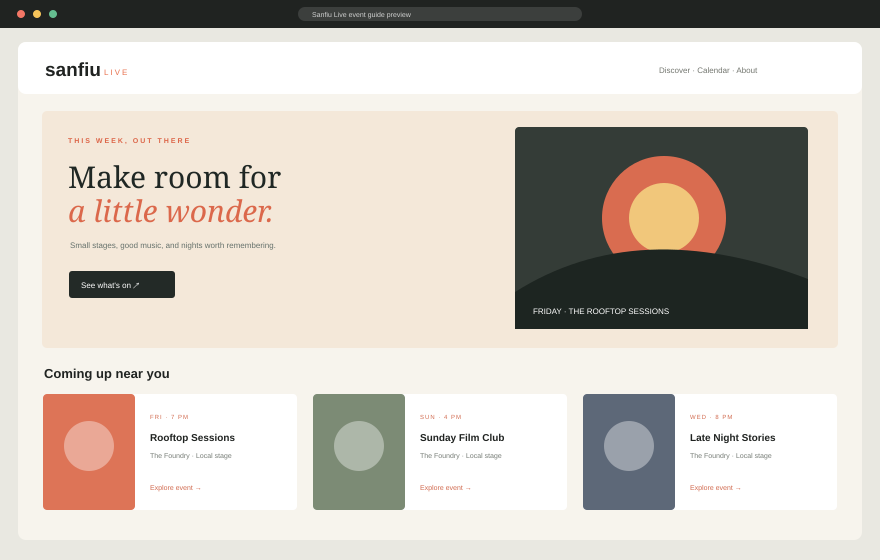

# Sanfiu Live

A customizable event discovery and ticket reservation starter. It includes a responsive event guide, category and text search, event detail pages, capacity-limited reservations, sample events, and a password-protected admin panel.



## Stack

- Python 3.10+
- Django 5.2 LTS
- SQLite for the quickest local start, or PostgreSQL with Docker Compose
- Django templates and plain CSS

## Run locally

From this folder:

```bash
python -m venv .venv
source .venv/bin/activate
python -m pip install -r requirements.txt
cp .env.example .env
python manage.py migrate
python manage.py seed_demo
python manage.py createsuperuser
python manage.py runserver
```

On Windows PowerShell, activate with `.venv\Scripts\Activate.ps1` and copy the environment file with `Copy-Item .env.example .env`.

Open `http://127.0.0.1:8000/` for events and `http://127.0.0.1:8000/admin/` to manage events and reservations.

To run with PostgreSQL in Docker, set a local password in `.env`, then run `docker compose up --build`. In another terminal, create an admin account with `docker compose exec web python manage.py createsuperuser`.

## Customize

- Change event names, descriptions, dates, and stock in the admin panel.
- Edit the event categories in `ticketing/models.py`.
- Update colors and layout in `static/css/site.css`.
- Change the demo listings in `ticketing/management/commands/seed_demo.py` and run `python manage.py seed_demo` again.

The sample listings use remote Unsplash image URLs. Replace them with images you have permission to use, or add a managed upload service.

## Before deploying

This starter records reservations and prevents the published ticket capacity from being exceeded. It does not take payment, email attendees, issue scannable tickets, or handle cancellations and refunds. Docker Compose is for local development. For a real event business, use PostgreSQL, configure email and payment providers, define cancellation rules, set a private `DJANGO_SECRET_KEY`, set `DJANGO_DEBUG=0`, configure `DJANGO_ALLOWED_HOSTS`, serve static files over HTTPS, and review Django's deployment checklist. Never use the sample secrets in production.

The software in this kit is MIT licensed. Sample photographs and remote services have separate terms.
