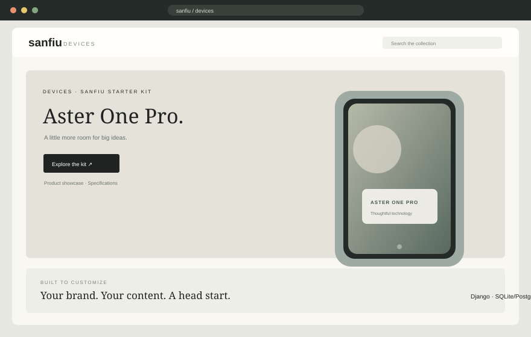

# Sanfiu Devices

An original device showcase starter with product storytelling, spec pages, and an inquiry workflow. The layout takes cues from clean product-launch sites while using its own brand, text, and assets.

## Included

- Django catalog with categories, featured devices, prices, descriptions, and specifications
- Responsive collection and product detail pages
- Inquiry form saved to the database and triaged in Django admin
- SQLite quick start or PostgreSQL through Docker Compose
- Sample phones and computers added with seed_demo

## Run locally

    python -m venv .venv
    source .venv/bin/activate
    python -m pip install -r requirements.txt
    cp .env.example .env
    python manage.py migrate
    python manage.py seed_demo
    python manage.py createsuperuser
    python manage.py runserver

Browse at http://127.0.0.1:8000/ and manage products and inquiries at /admin/. For PostgreSQL in Docker, set a local password in .env and run docker compose up --build. Seed the catalog with docker compose exec web python manage.py seed_demo and create the admin user with docker compose exec web python manage.py createsuperuser.

This is a product showcase, not a checkout system. Add a payment provider and stock workflow if customers need to buy online. Replace remote demo image URLs with properly licensed assets.

The software in this kit is MIT licensed. Sample photographs and remote services have separate terms.
