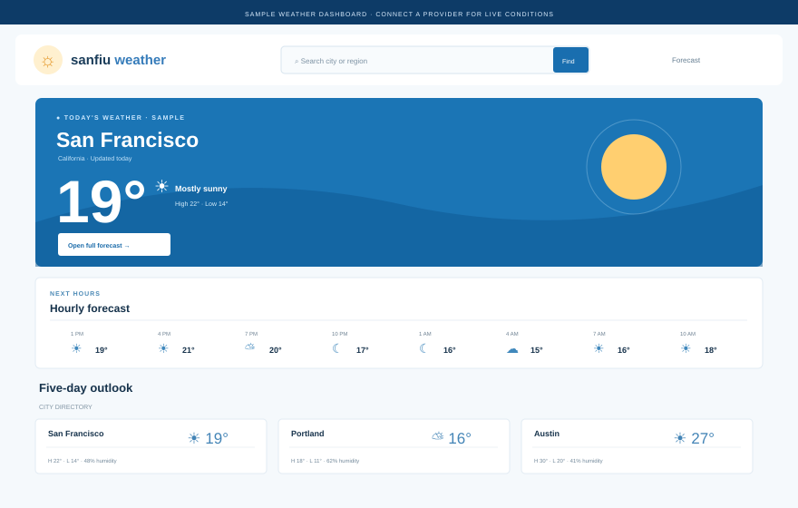

# Sanfiu Weather



A weather dashboard starter with a current-conditions panel, hourly forecast strip, 10-day city pages, location search, and Django admin. Its sample forecasts are editable database records. The project does not fetch live weather data until a provider is connected.

## Included

- Python 3.10+, Django 5.2, SQLite or PostgreSQL, Django templates and CSS
- Searchable city dashboard and individual city forecast pages
- Current conditions, humidity and wind details, sample hourly and 10-day records
- Admin management for cities, hourly forecasts, and daily forecasts
- Repeatable demo cities and forecast records via `seed_demo`
- Responsive interface with English copy

## Run locally

```bash
python -m venv .venv
source .venv/bin/activate
python -m pip install -r requirements.txt
cp .env.example .env
python manage.py migrate
python manage.py seed_demo
python manage.py createsuperuser
python manage.py runserver
```

Open `http://127.0.0.1:8000/` and manage weather data at `/admin/`. For local PostgreSQL in Docker, set a local password in `.env` and run `docker compose up --build`. Then use `docker compose exec web python manage.py seed_demo` and `docker compose exec web python manage.py createsuperuser`.

## Live data

The included current, hourly, and daily values are illustrative sample content, not forecasts for the listed cities. Connect a weather provider in the view or add a scheduled import command before showing conditions to visitors. Do not present the seeded values as live weather. Remote sample photography has terms separate from the MIT software license.
