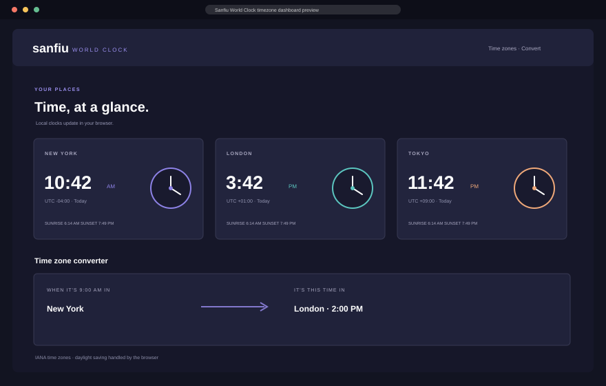

# Sanfiu World Clock

A full-stack world-clock starter with an admin-managed city list, live local clocks, and a browser-side time-zone converter. All interface copy is in English.

## Included

- Django model for locations and valid IANA time-zone names
- Live clocks and dates that tick in the browser using Intl.DateTimeFormat
- Time-zone conversion between the saved locations
- Django admin and sample cities
- SQLite quick start or PostgreSQL through Docker Compose

## Run locally

    python -m venv .venv
    source .venv/bin/activate
    python -m pip install -r requirements.txt
    cp .env.example .env
    python manage.py migrate
    python manage.py seed_demo
    python manage.py createsuperuser
    python manage.py runserver

Open http://127.0.0.1:8000/ and manage locations at /admin/. For PostgreSQL in Docker, set a local password in .env and run docker compose up --build, then run docker compose exec web python manage.py seed_demo and docker compose exec web python manage.py createsuperuser.

The site uses the browser's time-zone database for display and conversion. Add the locations your audience needs in admin. The sample stock images are not required for the time tools and are separate from the MIT software license.

The software in this kit is MIT licensed. Sample photographs and remote services have separate terms.
